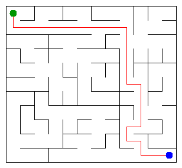

# Assignment 3. Maze Escape

- **Name:** Marat Ulan
- **Student ID:** 251669
- **Group:** SE-2532
- **Course:** Design and Analysis of Algorithms
- **Maze size:** 11 x 12 = 132 cells
- **Prepared:** 19 October 2026
- **Language:** Java 17, standard library only

This README is the assignment report. The supplied task is in `docs/Assignment3.pdf`; the original setup guide is `START_HERE.md`.

## Run the project

Run these commands from the `maze-escape` folder, which contains `src`, `tools` and `data`:

```bash
javac -encoding UTF-8 -d out src/*.java
java -cp out Main
```

The personal input files are already included. On Windows, `run.bat` compiles and runs the program and opens the maze page. On macOS/Linux, use `sh run.sh`. Open `output/maze.html` to see the animation, walk with the arrow keys, and switch on the path, zones, slides and cell numbers.

To recreate exactly this personal variant:

```bash
java tools/MakeVariant.java 251669 data
```

To check the supplied examples, run `java tools/Check.java`. This check replaces the pictures with an example maze, so run `java -cp out Main` afterwards to restore the personal pictures.

## Program output

Actual output of `java -cp out Main` on the included personal data:

```text
Broken: 131
Kept: 110
Last broken wall: 200
MST cost: 36063
Heaviest broken wall: 796
Path length: 23
DFS visited: 58
Dead ends: 40
Zones: 9
Largest zone: 28
Is DAG: 0
Flow stages: 9
Fastest route cost: 18
```

The input has 241 inner walls and 175 slides. Kruskal and Prim both return **36063**. `Last broken wall: 200` means wall record 200, counted after the header; its Java array index is 199.

### My maze



The picture and the 23-move path use the maze built in **Mission 1**, in file order. The cheapest maze in Mission 2 is a separate tree, used to calculate the MST statistics.

## Questions

### Mission 0. What do find and union do, and what makes them fast?

`find(x)` returns the root of the set containing cell `x`; `union(a, b)` joins two different sets and returns `true`, or returns `false` if they are already joined. Union by size puts the smaller tree under the larger tree, while path compression makes visited cells point directly to their root. Together they give an amortized cost of O(alpha(n)) per operation, where alpha(n) is the inverse Ackermann function and grows very slowly.

### Mission 1. Why are Broken and Kept always these numbers?

The complete rectangular grid is connected, and every successful union reduces the number of components by one without making a cycle, so connecting all R*C cells needs exactly R*C - 1 broken walls. The grid has R*(C-1) + C*(R-1) inner walls, so Kept = R*(C-1) + C*(R-1) - (R*C-1) = (R-1)*(C-1). For this 11 x 12 maze, Broken = 132 - 1 = 131 and Kept = 10*11 = 110.

### Mission 2. What are the Kruskal and Prim costs, and why are they equal?

Kruskal returns **36063**, and Prim also returns **36063** for this variant. Kruskal considers all walls from cheapest to most expensive and uses DSU to reject cycles, while Prim grows one tree using the cheapest wall crossing to an unvisited cell. Both algorithms find a minimum spanning tree; here all wall costs are different, so that tree is also unique.

### Mission 3. Why is there exactly one path, and how is stack overflow avoided?

The broken walls form a connected graph without cycles, which is a tree; two different simple paths between the same cells would create a cycle. The code uses an explicit array stack and remembers the next direction in each stack frame, so it follows the required up, right, down, left order without recursive Java calls. It stops when the exit is first marked, giving 23 moves and 58 visited cells; the 40 dead ends are counted across the whole maze.

### Mission 4. Why reverse the graph, and why does Zones = cells mean no cycle?

The first DFS records finishing order, and the second DFS processes cells from last finished to first on the reversed slides; this order prevents a search from entering a different, still unassigned component. Reversing all edges preserves mutual reachability inside a strongly connected component, so each second-pass search finds exactly one zone and the resulting zone numbers are in topological order. Since the input has no self-loops, a cycle exists exactly when a zone contains at least two cells, so the slides form a DAG exactly when the number of zones equals the number of cells.

### Mission 5. Why are zone numbers enough, and what does the pass cost?

Every slide between different zones goes from a smaller zone number to a larger one, so all incoming contributions are ready when that zone is processed. For each zone, the code keeps the cheapest slide to each target, updates the longest chain from any starting zone, and updates the cheapest distance from the start zone; movement inside a zone costs zero. Grouping the slides and processing the routes costs O(S + Z) time and space, while the relaxations on the distinct zone edges alone cost O(Z + E_zone).

## AI use

**Tool used: ChatGPT.** ChatGPT assisted with algorithm design, generated the initial Java implementations and additional checks, helped examine edge cases, and drafted this README and the companion study guide. Automated checks and benchmarks were run in the assistant's Linux / Java 17 execution environment.

This is an **AI-assisted preparation version**. The student must review, adapt and understand the submitted code and explanations, in line with the assignment rules; this report does not claim that the student independently wrote or personally verified every line. The local commits record the actual preparation stages in this session and use the configured author, Codex.

Sources: the instructor-provided starter ZIP, `START_HERE.md`, and the supplied assignment PDF. No external graph or DSU library is used, and no code was copied from a website or book.

## Timing (Mission 7)

Actual results from the unchanged supplied `Bench` class, measured on 19 October 2026. Environment: Linux x86_64, OpenJDK 17.0.20, maximum Java heap 2 GiB. These are execution-environment measurements, not measurements from the student's laptop.

```bash
java -Xmx2g -cp out Bench
```

Milliseconds, five runs per algorithm; the averages below are the averages printed by `Bench`:

| Maze | Cells | Kruskal: five runs (ms) | Average (ms) | Prim: five runs (ms) | Average (ms) |
|---|---:|---|---:|---|---:|
| 100 x 100 | 10,000 | 20, 9, 8, 22, 28 | 17 | 21, 9, 6, 7, 8 | 10 |
| 300 x 300 | 90,000 | 159, 75, 66, 66, 65 | 86 | 86, 75, 73, 89, 85 | 81 |
| 1000 x 1000 | 1,000,000 | 1206, 1269, 1331, 1151, 1218 | 1235 | 2646, 2661, 2734, 2300, 2220 | 2512 |

The input size is the number of cells, so increasing the side from 100 to 1000 increases n by 100 times. On a grid the number of walls is proportional to n, so both implementations have O(n log n) time; the largest measured maze takes about 1.24 seconds for Kruskal and 2.51 seconds for Prim. JVM warm-up, garbage collection and scheduling affect the individual runs, so these measurements illustrate growth and do not prove an exact scaling ratio.

The original benchmark output is saved in `output/bench.txt`. `Bench` prints each run and the average after rounding; an average of the displayed integers can therefore differ slightly from its displayed average.

## Complexity

Let n be the number of cells, M the number of walls, B the number of broken walls, S the number of slides, Z the number of zones, and E_zone the number of distinct directed edges between zones. Space includes the additional data structures used by the algorithm; the input itself is not counted again.

| Algorithm | Time | Extra space | Assumptions |
|---|---|---|---|
| DSU find and union | O(alpha(n)) amortized per operation | O(1) per operation; O(n) for the DSU | Union by size and iterative path compression; constructor O(n) |
| Build maze in file order | O(n + M alpha(n)) | O(n) | Connected rectangular grid; stop after n-1 successful unions |
| Kruskal | O(n + M log M) | O(n + M) | Sort wall indexes, then use DSU |
| Prim | O(n + M log M) | O(n + M) | Priority queue of wall indexes; each wall enters at most once |
| DFS escape | O(n + B) | O(n + B) | B = n-1; at most four grid neighbours; explicit stack |
| Kosaraju | O(n + S) | O(n + S) | Two iterative DFS passes and forward/reversed lists |
| Route in the zone graph | O(S + Z) total; O(Z + E_zone) for relaxations | O(S + Z) | Topological zone numbering; parallel slides reduced to minimum cost |

For the connected grid M = Theta(n), Kruskal and Prim are O(n log n) time and O(n) extra space. For a connected simple graph, the Prim bound can also be written O(M log n).

## Validation

- `DisjointSetTest`: all **21** checks pass, including repeated unions, union by size, the single-cell case, an empty DSU and a 100,000-cell chain.
- `java tools/Check.java`: `tiny`, `small` and `dag` each match all **13** expected lines.
- The personal run prints all 13 required lines and no Kruskal/Prim warning.
- `tools/AlgorithmChecks.java`: **7279 assertions** pass in normal mode; **7286 assertions** pass with `--stress`. These are assertion counts, not distinct input counts.
- Independent references cover 36 tiny grids (exhaustive MST and a small recursive DFS oracle) and 160 deterministic random slide graphs (Floyd-Warshall reachability and route checks).
- The stress run visits **1,000,000 cells** in a 1000 x 1000 maze, with **999,999 cells in the escape path**, and checks a 200,000-vertex slide chain and cycle without recursion.

```bash
java -cp out tools/AlgorithmChecks.java
java -Xmx2g -cp out tools/AlgorithmChecks.java --stress
```

Logs are included under `output/`. The unchanged supplied files are `Main.java`, `Input.java`, `Graphs.java`, `Render.java`, `Generator.java`, `Bench.java`, and the supplied tools and example data.

## Project files

- `src/DisjointSet.java`: parent/size arrays, union and path compression.
- `src/Maze.java`: file-order maze, Kruskal, and Prim.
- `src/Escape.java`: iterative DFS and dead-end count.
- `src/Zones.java`: iterative Kosaraju and routes in the zone graph.
- `src/DisjointSetTest.java`: supplied checks plus extra DSU checks.
- `data/walls.txt`, `data/slides.txt`: personal data for ID 251669.
- `output/maze.png`, `output/maze.html`: personal picture and interactive maze.
- `tools/AlgorithmChecks.java`: additional independent validation.

## Submission

The required submission is a **public GitHub repository link in Moodle**, as stated in the supplied PDF. This local package does not by itself publish a repository or submit anything to Moodle.

The package includes the prepared `main` branch and its local Git history. After creating an empty public repository in your own GitHub account, publish from this project folder; replace `YOUR_USERNAME` with the actual account name:

```bash
 git remote add origin https://github.com/YOUR_USERNAME/maze-escape.git
 git push -u origin main
```

Do not delete `.git` if you want to keep the included mission commits. If that hidden folder is lost when transferring files, the companion `maze-escape-history.bundle` can restore the repository with `git clone maze-escape-history.bundle maze-escape-restored`.

Before submitting, check your ID/name/group, review and adapt the AI-assisted work, confirm the public repository opens without signing in, and paste its real link into Moodle before the deadline. The defense is five minutes: one mini task and two questions; the task assigns 50 points to the project and 50 to the defense.
